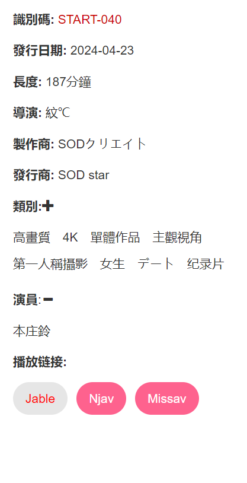
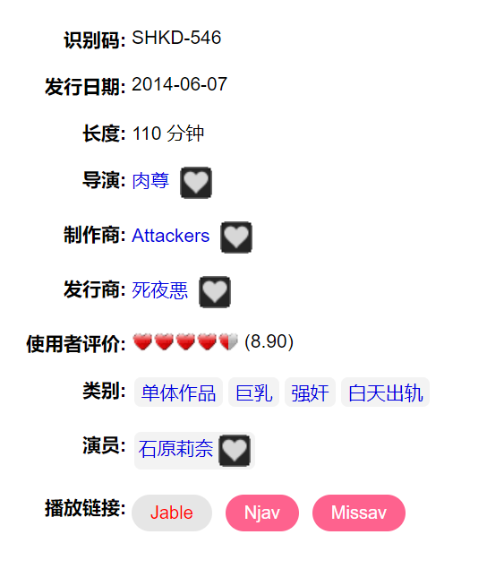

# JavLinker

**把 Jav 网站连接起来的浏览器扩展**（Chrome / Firefox，Manifest V3）

在数据库（DB）类网站自动注入播放链接，在播放（Player）类网站反向提供数据库详情页入口；同时在**所有网站**上支持选中番号文字（如 `SSIS-001`）快速搜索全部视频源。

## 功能

- **站点互通**：访问 DB 站点（JavBus、JavLibrary、JavDB）时自动列出各播放站的播放链接；访问播放站（Jable、123av、Missav 等）时自动提供 JavDB 详情页入口
- **全站番号搜索**：在任意网页选中番号文字，选区附近弹出悬浮按钮，点击后展开面板，一次性列出并搜索所有 Provider 的结果
- **统一的结果处理**：多结果时弹窗选择、错误时按钮提示、支持强制新标签页 / 后台打开

<p>
  
  
</p>

## 安装使用

1. 下载本项目
2. 打开[扩展程序页面](chrome://extensions/)（Firefox 为 `about:debugging#/runtime/this-firefox`）
3. 右上角勾选**开发者模式**
4. 加载已解压的扩展程序 → 选择 `dist_chrome`（或 `dist_firefox`）目录

也可以直接使用 `release/` 下已打包好的 `jav_linker-*-chrome.zip` / `jav_linker-*-firefox.xpi`。

## 插件设置

点击工具栏插件图标，可配置：

| 设置 | 说明 |
| ---- | ---- |
| 强制使用插件打开标签页 | 所有链接经插件新标签页打开 |
| 从后台打开 | 依赖上一项，新标签在后台静默打开 |
| 选中番号文字时显示搜索按钮 | 全站悬浮按钮功能开关，默认开启 |

## 核心概念

- **Platform（平台）**：扩展**运行在其上**的网站，负责解析页面信息并向 DOM 注入链接
- **Provider（提供者）**：扩展要**跳转去**的数据源网站，负责根据番号搜索并返回结果链接

两者均为抽象类，通过"继承 + 组合"扩展新站点。详细架构设计见 [docs/design.md](docs/design.md)。

## 开发

环境要求：Node.js 20+，npm。

```bash
npm install          # 安装依赖

npm run dev:chrome   # Chrome 调试（热更新，端口 5173）
npm run dev:firefox  # Firefox 调试（端口 5174）

npm run build:chrome   # 构建 Chrome 版本到 dist_chrome
npm run build:firefox  # 构建 Firefox 版本到 dist_firefox
npm run build          # 两个浏览器全部构建并打包到 release/
```

### 目录结构

```
├── manifest_chrome.json      # Chrome 扩展清单
├── manifest_firefox.json     # Firefox 扩展清单
├── vite.config.ts            # 按 mode 区分双浏览器构建配置
├── build_scripts/            # 构建前后脚本（清理 dist / web-ext 打包）
└── src/
    ├── content.ts            # 内容脚本入口：匹配 Platform + 启动选中监听
    ├── background.ts         # 后台脚本：代理 fetch / cookie / 新标签页
    ├── platforms.ts          # 平台注册表（db + player）
    ├── providers.ts          # 提供者注册表（player + db）
    ├── platforms/            # 平台实现（db / player / selection）
    ├── providers/            # 提供者实现（db / video）
    ├── models/               # 领域模型（Result / Info / SearchData 等）
    ├── tools/                # 基础设施（网络 / 存储 / 设置 / 番号识别）
    ├── css/                  # 注入样式
    └── popup/                # 弹出设置页
```

### 扩展新站点

**新增一个播放提供者**（最常见）：

1. 在 `src/providers/video/` 新建 `XxxProvider.ts`，继承 `Provider`，实现 `search(info)`
2. 在 `src/providers.ts` 的 `playerProviders` 数组中注册（受 `enable` 过滤）

**新增一个平台**（在其页面上显示链接的站点）：

1. 在 `src/platforms/db/` 或 `src/platforms/player/` 新建 `Xxx.ts`，继承 `Platform`，实现 `match` / `getInfo` / `applyPlugin`
2. 在 `src/platforms.ts` 的 `dbPlatforms` / `playerPlatforms` 注册

> 内容脚本当前匹配 `<all_urls>`，新平台按 host 自动生效，无需改 manifest。

## 支持的站点

| 站点 | 类型 | 作为平台 | 作为提供者 |
| ---- | ---- | :------: | :--------: |
| javbus.com / seejav.me | DB | ✅ | — |
| javlibrary.com / y78k.com | DB | ✅ | — |
| javdb.com | DB | ✅ | ✅ |
| jable.tv | Player | ✅ | ✅ |
| 123av.com | Player | ✅ | ✅ |
| mf2607.com | Player | ✅ | ✅ |
| missav.ws | Player | ✅ | ✅ |
| japanhub.net | Player | — | ✅ |
| javhdporn.net | Player | — | ✅ |
| njav.com | Player | — | ✅ |
| supjav.com | Player | — | ✅ |

## License

[MIT](LICENSE) © veckdev
